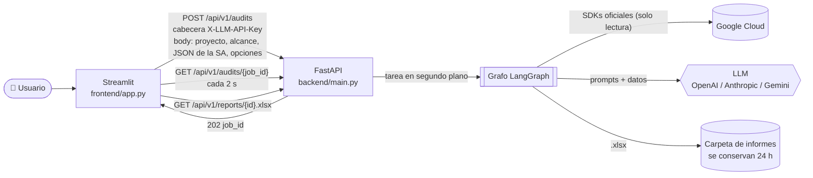
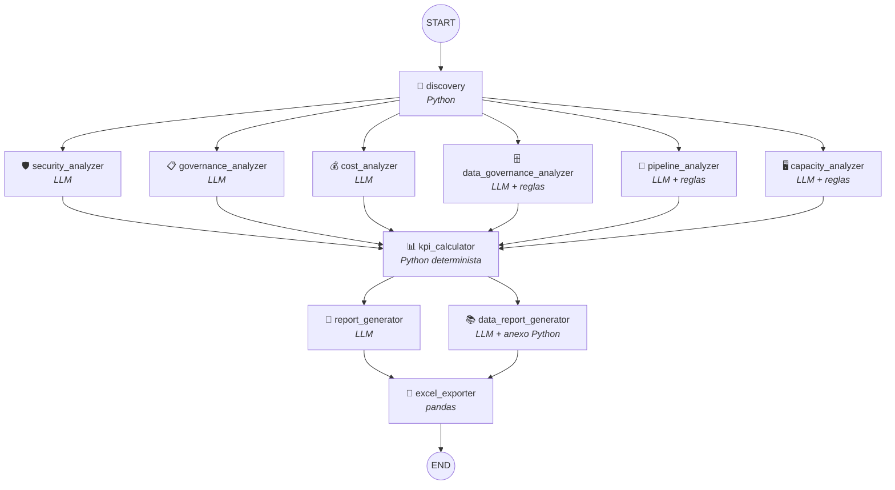
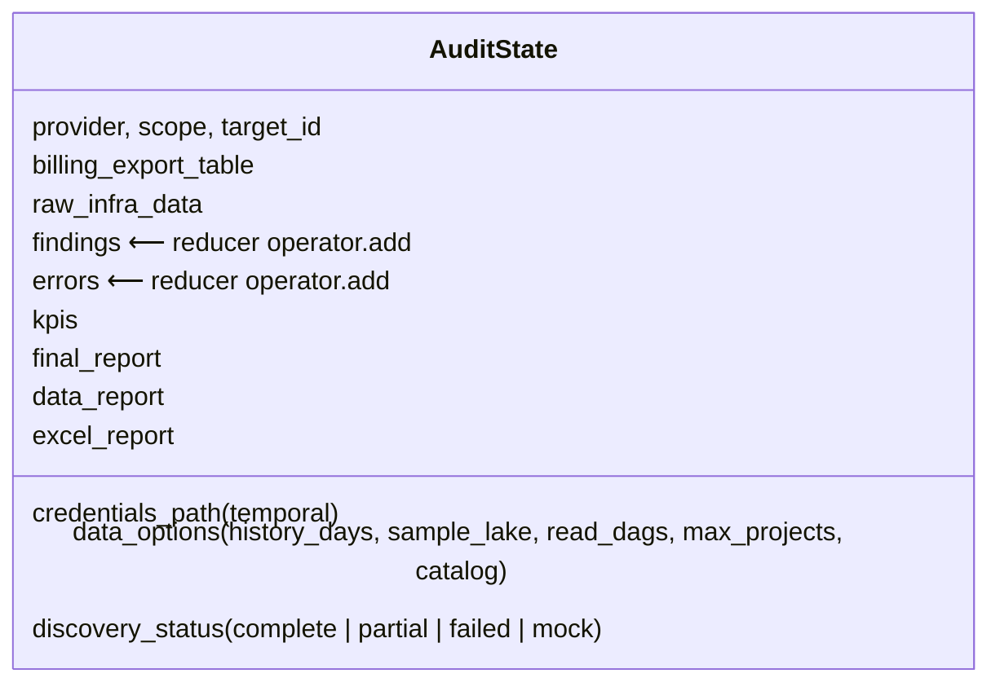
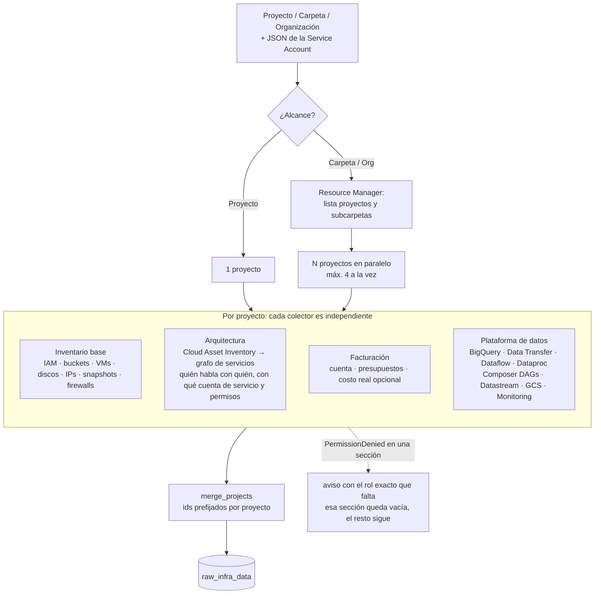
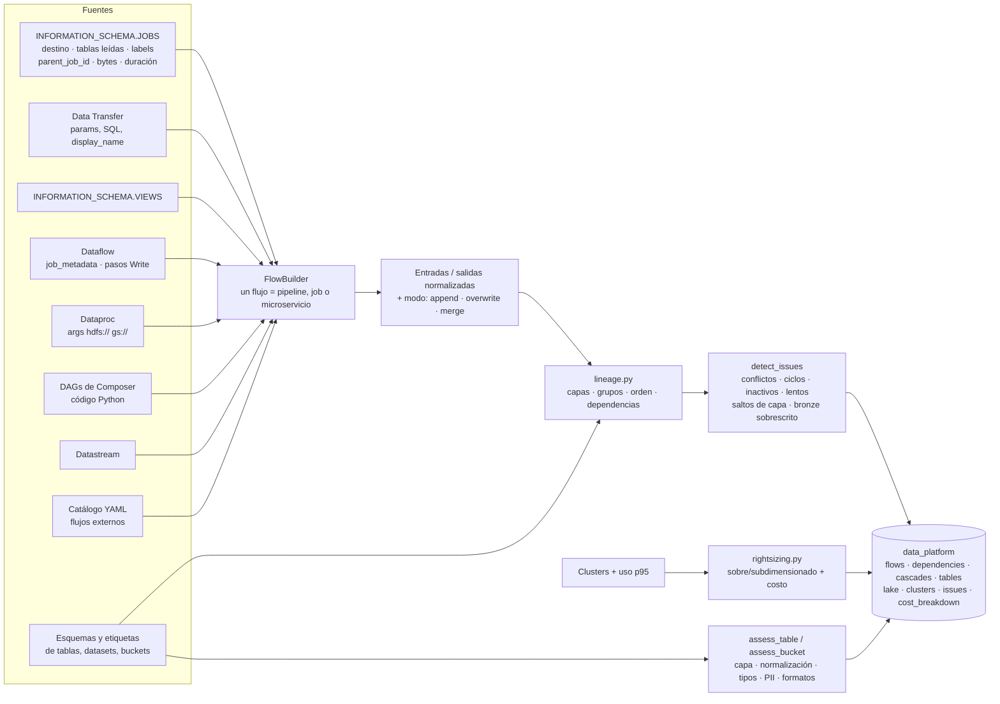
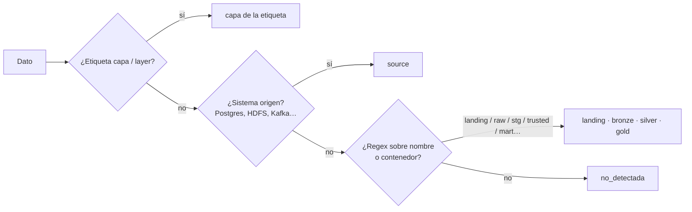
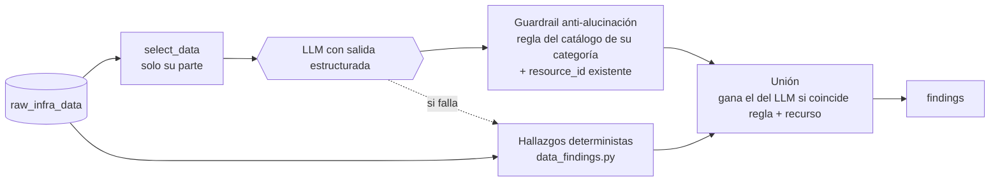
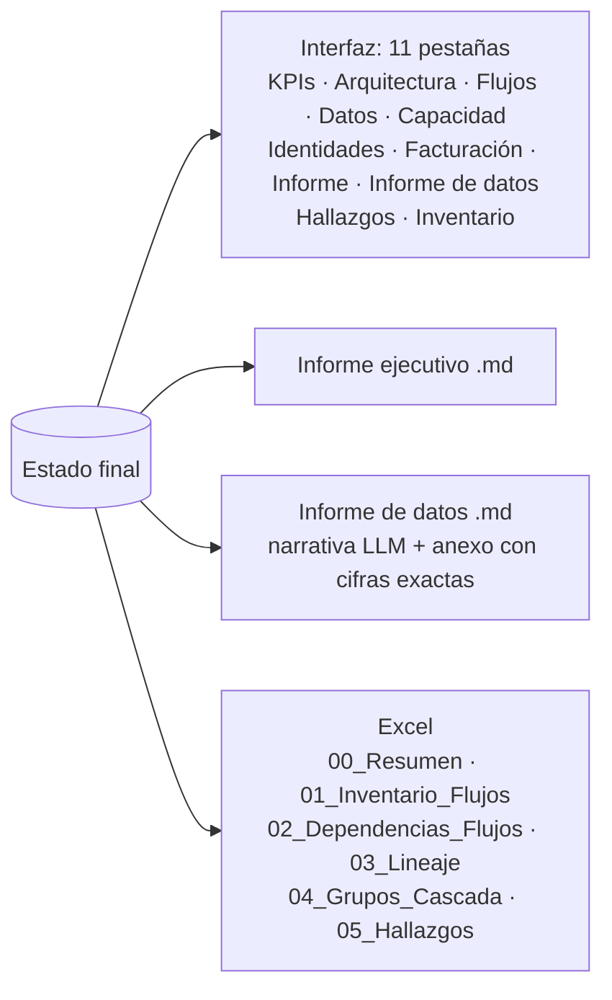

# Cloud Tech Debt Analyzer: cómo funciona el agente (v1.4)

## 1. Vista general



- La **API Key del LLM** viaja en una cabecera y se inyecta en `config["configurable"]`. Nunca entra en el estado, los logs ni las respuestas.
- El **JSON de la Service Account** se escribe en un archivo temporal con permisos `0600` y se borra al terminar. En el estado solo queda su ruta.

## 2. Grafo de agentes (LangGraph)



| Fase | Nodos | Qué hace |
|---|---|---|
| Descubrimiento | `discovery` | Lee GCP y construye `raw_infra_data`. No usa LLM. |
| Análisis en paralelo (fan-out) | 6 analizadores | Cada uno recibe solo su parte del inventario y devuelve `findings`. |
| Unión (fan-in) | `kpi_calculator` | Calcula índices de deuda (0-100), grado A-E y KPIs por dominio. |
| Informes en paralelo | `report_generator`, `data_report_generator` | Informe ejecutivo e informe de datos en Markdown. |
| Exportación | `excel_exporter` | Excel con inventario, dependencias, linaje, cascadas y hallazgos. |

## 3. Estado compartido (`AuditState`)



`findings` y `errors` usan el reducer `operator.add`, así los seis analizadores escriben en paralelo sin pisarse.

## 4. Descubrimiento (`discovery`)



## 5. Motor de plataforma de datos (determinista)



### 5.1 Cómo obtiene el input y el output de un flujo

| Motor | Entradas | Salidas | Modo de escritura |
|---|---|---|---|
| Job de BigQuery | `referenced_tables` | `destination_table` | `statement_type` / `write_disposition` |
| Carga (LOAD) | `source_uris` | `destination_table` | `write_disposition` |
| Consulta programada / vista | `FROM` / `JOIN` del SQL | `INSERT` / `MERGE` / `CREATE` del SQL | según el verbo SQL |
| Transferencia GCS→BQ | `data_path_template` | `destination_table_name_template` | `APPEND` / `MIRROR` |
| Dataflow | `job_metadata` | pasos `Write*` / `Sink` | streaming = append |
| Dataproc | args `--input` | args `--output` | `overwrite` / `append` en args |
| Composer | operadores (bucket, conexión) | `destination_*_table` | `write_disposition` |
| Catálogo | declarado | declarado | declarado |

Si algo no se detecta, queda `no_detectada` y se genera el hallazgo `LINEAGE_UNDETECTED`.

### 5.2 Cómo infiere la capa



La capa de un flujo es la más alta entre sus entradas (`capa_entrada_inferida`) y entre sus salidas (`capa_salida_inferida`). Las etiquetas del propio job (`capa_entrada`, `capa_salida`) tienen prioridad.

### 5.3 Cómo agrupa en cascadas

```mermaid
flowchart TD
    F[Flujo] --> P1{1. ¿Etiqueta grupo_cascada<br/>en el job? @@query_label}
    P1 -- sí --> G[grupo]
    P1 -- no --> P2{2. ¿Prefijo '[grupo]'<br/>en el nombre?}
    P2 -- sí --> G
    P2 -- no --> P3{3. ¿Etiqueta en las tablas o<br/>buckets que escribe / lee?}
    P3 -- sí --> G
    P3 -- no --> P4{4. ¿Conectado por linaje a<br/>flujos de un único grupo?}
    P4 -- sí --> G2[hereda ese grupo]
    P4 -- no --> P5[5. componente conexo<br/>grupo auto-xxxx]
    G & G2 & P5 --> O[orden_en_cascada<br/>profundidad en el grafo de dependencias]
```

Hay una dependencia **A → B** cuando una salida de A es entrada de B.

## 6. Analizadores (patrón común)



| Analizador | Evalúa |
|---|---|
| Seguridad | mínimo privilegio, servicios públicos, cuentas de servicio por defecto, secretos en variables de entorno, bases de datos expuestas |
| Gobierno | etiquetas, cifrado, backups |
| Costos | recursos huérfanos u ociosos, presupuestos, servicios siempre encendidos |
| Gobierno de datos | capa correcta, normalización, tipos, PII, particionado, data lake, HDFS |
| Flujos | conflictos, ciclos, inactividad, fallos, lentitud, escaneos completos, cascadas sin grupo o con varios dueños |
| Capacidad | clusters Dataproc, GKE, Cloud SQL y Composer frente al uso p95, con costo actual y recomendado |

## 7. Salidas



## 8. Principios de diseño

- **El LLM no calcula cifras.** Precios, KPIs, dimensionamiento y linaje salen de Python; el LLM los explica y prioriza.
- **Resiliencia.** Un permiso faltante, un proyecto roto o un LLM caído no detienen la auditoría: se registra el aviso y se continúa.
- **Solo lectura.** Las consultas a `INFORMATION_SCHEMA` tienen un tope de bytes facturados y el agente excluye sus propios jobs del análisis.
- **Seguridad de salida.** El Excel neutraliza fórmulas y caracteres de control. Los diagramas Mermaid generados por el LLM se dibujan en modo `strict`.